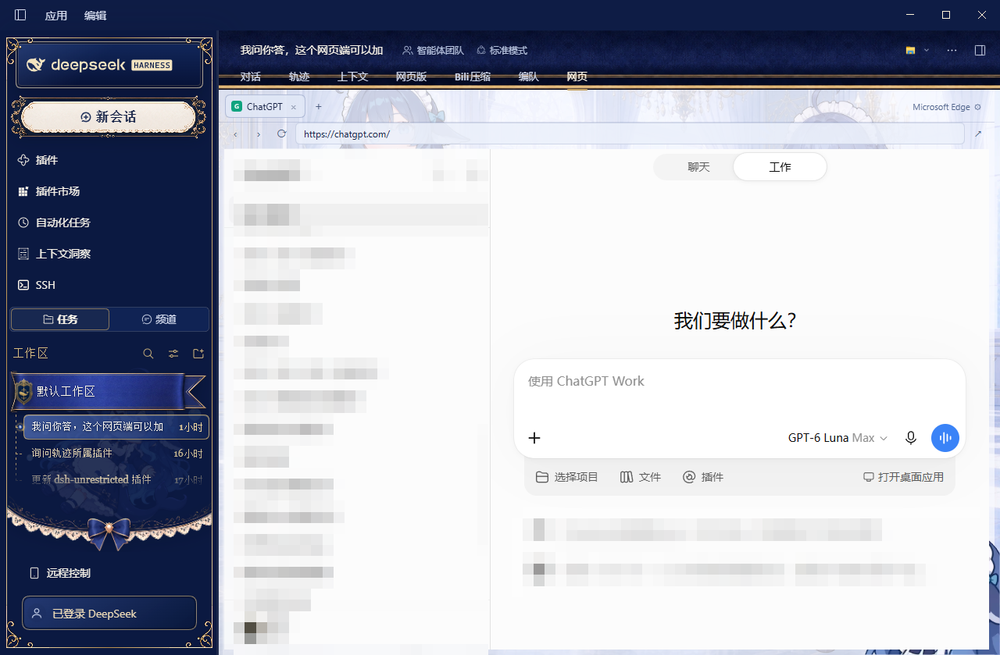

# dsh-web-tabs

给 DSH NEXT 桌面端加一个**多页签内置浏览器**页签（页签名「网页」）。可以同时开着
ChatGPT、Claude、Gemini、Grok、muse.ai、DeepSeek，也可以加任意自定义网址。

两套引擎，自动选择：

| 引擎 | 什么时候用 | 登录态 | Google 账号 |
| --- | --- | --- | --- |
| **edge**（优先） | 装了 Edge / Chrome / Brave / Vivaldi 的 Windows | 真实浏览器的 profile，**跨重启保留** | ✅ 可以（它就是一个真的浏览器窗口） |
| **webview** | 没有浏览器可拉时兜底 | 进程内 partition，重启清空 | ❌ 被 Google 拦 |

edge 引擎不是「模拟浏览器」：host 半侧 spawn 一个**真的浏览器 app 模式窗口**，再用
Windows 的 `SetParent` 把它变成 DSH 主窗口的子窗口，按面板矩形摆放，并用
`SetWindowRgn` 裁掉它自绘的标题条。所以它就是那个浏览器 —— Google 认、Cloudflare 不拦、
下载和麦克风都按浏览器自己的策略走，只是长得像面板里的一个区域。

用哪个浏览器不用改代码：点页签条右端的**齿轮**就能换（见下面「换浏览器 / 换 profile」）。



> 拿到别的电脑上验收？看 [ACCEPTANCE.zh.md](ACCEPTANCE.zh.md)：里面有逐条验收清单、
> 本机的实测输出摘录、以及**还没验证过的项目**（Chrome / Brave / Vivaldi、高 DPI 等）。

## 它长什么样

- 会话页签栏里多一个「网页」页签。
- 页签内部自上而下：站点页签条 → 地址栏（后退 / 前进 / 刷新 / 网址 / ↗）→ 网页本体。
- 「＋」弹出菜单：6 个预设站点 + 自定义网址输入框。
- 页签切换**不重载**：另一个页签的窗口只是被 `SW_HIDE`，登录状态、对话进度、滚动位置都留在原地。
- 中键点页签可关闭；关掉的页签会 detach + 关闭对应的浏览器窗口。

## 安装

### 分发包

`dist/` 里有两个，内容完全相同（13 个文件）：

| 文件 | 适合 |
| --- | --- |
| `dsh-web-tabs-0.2.1.zip` | Windows 上直接右键「全部解压」，解压出来是 `dsh-web-tabs\` 文件夹 |
| `dsh-web-tabs-0.2.1.tgz` | npm / tar 习惯，解压出来是 `package\` 文件夹 |

### 一键安装（推荐）

把插件目录（或解压后的 zip / tgz）放进任意位置，在**该目录**里打开 PowerShell：

```powershell
powershell -ExecutionPolicy Bypass -File .\install.ps1
```

`install.ps1` 会做三件事：

1. 找到你的 DSH 数据目录（`$env:DSH_DATA_DIR`，默认 `~/.dsh`）和当前 profile（默认
   `desktop`，可用 `-Profile <名字>` 指定）；
2. 把插件文件拷到 `<数据目录>/profiles/<profile>/node_modules/dsh-web-tabs/`；
3. 往 `<profile>/cordis.patch.yml` 里**幂等**插入下面这段（已经有就不重复插）：

```yaml
- insert:
    - id: dsh-web-tabs
      name: dsh-web-tabs
      config: {}
```

装完会提示你**完全退出并重新打开 DSH NEXT**（不是 `Ctrl+R` —— 那只是刷新界面）。

其它参数：

```powershell
powershell -ExecutionPolicy Bypass -File .\install.ps1 -Profile other -DataDir D:\mydsh -DryRun
```

`-DryRun` 只打印将要做什么，不落盘。

### 卸载

```powershell
powershell -ExecutionPolicy Bypass -File .\uninstall.ps1
```

会删掉 `node_modules/dsh-web-tabs/` 和 `cordis.patch.yml` 里那段 `insert`，同样需要
重启 DSH NEXT。加上 `-KeepData` 可以保留 `~/.dsh/web-tabs/`（登录态缓存、settings.json）。

### 手动安装

把整个 `dsh-web-tabs/` 目录拷进 `<profile>/node_modules/`，再把上面那段 `insert` 追加到
`<profile>/cordis.patch.yml`。

**首次安装，或改过 `lib/index.js` / `lib/embed.js` / `native/win.ps1` 之后，要完整重启一次
DSH NEXT。** 按 `Ctrl+R` 只重载渲染进程，host 半侧（Node 侧插件）不会重载 —— 宿主没有插件
热重载机制。客户端半侧（`lib/client.js`）改完则 `Ctrl+R` 就生效。

## 使用

| 操作 | 做法 |
| --- | --- |
| 新建预设页签 | 点「＋」→ 选站点 |
| 新建任意站点 | 点「＋」→ 在「自定义网址」里输入（`example.com` 会自动补 `https://`）→ 回车或点「打开」 |
| 切换页签 | 点页签条 |
| 关闭页签 | 点页签上的 `×`，或中键点页签 |
| 同一站点开第二个页签 | 点「＋」再选一次（各自独立窗口，登录态共享） |
| 站内弹窗（`target=_blank`） | edge 引擎：就是浏览器自己的新窗口；webview 引擎：转成新页签 |
| 导航 | 地址栏里输入后回车 |
| 用系统默认浏览器打开当前页 | 点地址栏右端的 **↗** |

地址栏的输入框语义仿浏览器：**从别处点进来时全选**（直接打字即新网址），已经聚焦时
再点则是正常放光标（方便改域名后缀）。Esc 放弃编辑、还原成当前网址。

## 换浏览器 / 换 profile

页签条最右端有个**齿轮**，上面写着当前在用的浏览器名（比如「Microsoft Edge」）。点它：

- 列出插件认识的四个浏览器（**装没装都列**，没装的标「未安装」、不能选）：Edge、Chrome、
  Brave、Vivaldi。除了 Edge，其它三个标「未实测」—— 机制一样，但作者没有逐台机验过。
- 当前这个浏览器有多个 profile 时，会把它们都列出来（登过 Google 账号的标「登过 Google」），
  点一下就换到那个 profile。**换 profile 就等于换一套登录态。**
- 底下「其它浏览器」可以填任意 Chromium 内核浏览器的 `.exe` 完整路径（Chromium、Arc、
  便携版、绿色版都行）。**Firefox / Safari 不行** —— 嵌入靠的是 Chromium 的窗口结构。
- 选完立刻生效：已打开的页签会被关掉，然后按新浏览器重新打开（登录态跟着新 profile 走）。

不点齿轮也可以，优先级从高到低：

1. 齿轮里选的（存在 `~/.dsh/web-tabs/settings.json`）；
2. 环境变量 `DSH_WEB_TABS_BROWSER`（浏览器 id 如 `edge`，或 exe 绝对路径）；
3. **这台机器上最近用过的那个浏览器**（比 `Local State` 的修改时间）—— 登录态最可能在那儿；
4. 配置表顺序第一个装了的。

齿轮里的「自动选择」会清掉第 1 条，回到 3/4。

## Google 账号登录

- **edge 引擎**：这就是真的浏览器，`accounts.google.com` 正常放行。默认跑在 **shared**
  模式 —— 不传 `--user-data-dir`，只传 `--profile-directory=<你最近用的 profile>`，直接复用
  你系统浏览器已有的那个 profile，所以你**平时在浏览器里登录过的账号，面板里打开就是已登录**
  （ChatGPT 的「Continue with Google」、Gemini 全都能用）。
- **webview 引擎**：Google 从 2021 年起禁止在内嵌浏览器里登录账号（OAuth 错误码
  `disallowed_useragent`，页面原文「此浏览器或应用可能不安全」）。改 UA、伪造
  `navigator.userAgentData` / `webdriver` 都过不去。此时只能：
  - ChatGPT / Claude / Grok：用邮箱密码 / 邮箱验证码 / X 账号登录；
  - Gemini、Gmail：点 **↗** 交给系统浏览器。

### 两种 profile 模式

`lib/embed.js` 支持两个模式，构造 `EdgeEmbedder` 时读环境变量 `DSH_WEB_TABS_PROFILE_MODE`：

| 模式 | 启动参数 | 登录态 | CDP（精确导航 / 读网址标题） |
| --- | --- | --- | --- |
| **shared**（默认） | `--profile-directory=<你最近用的那个>`，**不传** `--user-data-dir` | ✅ 用户自己的 | ❌ 命令行被转发给已有实例，调试端口起不来 |
| **isolated** | `--user-data-dir=<插件目录>` + `--remote-debugging-port=<n>` | ❌ 空 profile | ✅ |

之所以默认 shared：登录态比 CDP 重要得多。没有 CDP 的代价是导航靠「关掉窗口用新网址
重开」（登录态在 profile 里，不会丢），以及当前网址标题靠 `GetWindowText` 轮询。

切到 isolated：

```
DSH_WEB_TABS_PROFILE_MODE=isolated
```

## 已知限制

1. **edge 引擎只在 Windows 上可用**（`SetParent` 是 Win32 API）。其它平台自动退回
   webview 引擎；webview 引擎只在 DSH NEXT 桌面端可用（浏览器里打开的 DSH 没有
   `dshDesktop.browser` 桥，会显示降级提示）。
2. **edge 引擎的窗口盖在所有 DOM 之上**（原生子窗口不属于浏览器合成层）。所以页签菜单
   一打开，宿主会把浏览器窗口藏起来再显示（这就是 `/embed/overlay` 的用途）。同理，
   面板里的任何浮层都不能盖住它。
3. **webview 引擎的登录态不跨重启**。partition 名是 `dsh-sidebar-browser-<uuid>`，
   没有 `persist:` 前缀，关掉 DSH NEXT 后 cookie / localStorage 清空。
4. **webview 引擎不能下载文件、不能用麦克风 / 摄像头 / 定位**（主进程一律
   `preventDefault` / 拒绝）。edge 引擎没有这些限制。
5. **shared 模式下读不到网址**。默认的 shared 模式没有 CDP（Chromium 把命令行转发给
   已有实例，`--remote-debugging-port` 被忽略），当前网址只能拿启动时请求的那个，页内跳转
   靠窗口标题推测；标题含中文时靠 `GetWindowText` 轮询。想精确读网址就切到 isolated。
6. **isolated 模式下浏览器是单独起的**。`--remote-debugging-port` 从 9300 往上找一个空闲
   端口，端口和 profile 记在 `~/.dsh/web-tabs/embed-state.json`，下次启动优先复用。
7. **isolated 模式下同 profile 的残留进程会被清掉**。Chromium 对 `--user-data-dir` 独占，
   残留实例会让调试端口永远起不来，所以 `ensureCdp()` 会先按命令行杀掉占着本 profile 的
   msedge / chrome。**shared 模式绝不做这件事**（会关掉用户自己的所有标签页）。
8. **切换页签会把非激活窗口 `SW_HIDE`**，所以后台页签里的视频会暂停、定时器被节流。
   这是为了让 Windows 的 occlusion 计算不去暂停前台那个窗口。
9. **中文标题依赖 UTF-8 管道**。`native/win.ps1` 开头把 `[Console]::In/Out` 都钉成无 BOM
   的 UTF-8；否则 PowerShell 5.1 会按 OEM 代码页（简中机器是 936/GBK）读写 JSON，标题
   里的中文就成乱码。**因此 `win.ps1` 必须全 ASCII** —— PS 5.1 会把无 BOM 的脚本当 OEM
   代码页解析，注释里写中文可能直接语法错误。
10. **刷新 DSH NEXT 主窗口（`Ctrl+R`）**：webview 引擎会回收所有 lease 并重建 webview；
    edge 引擎的窗口不受影响，但矩形会重新上报一遍（会闪一下）。
11. **标题条高度按 DPI 缩放**。Chromium 的非客户区是物理像素画的：100% 缩放 30px、
    125% ≈38px、150% ≈45px。`tick()` 里按 `dpr` 换算，125%/150% 的机器上页面顶部才不会被切掉。
    UIA 能量出真实值时（Chrome / Brave 有时候可以）优先用实测值。
12. **只支持 Chromium 内核**。Firefox / Safari / WebKit 没有 `Chrome_WidgetWin_1` 这套窗口
    结构，`SetParent` 之后再裁标题条也不成立，所以不在支持范围。
13. **其它三个浏览器没逐一实测**。Chrome / Brave / Vivaldi 走的是同一条代码路径（只是 exe
    路径和进程名不同），但作者手上只有 Edge，所以标「未实测」。真机遇到问题请把
    `~/.dsh/web-tabs/settings.json` 和面板的报错文案一起发出来。

## 实现要点（改代码前先看这几条）

### 通用

- **`shell.overlay` 是单例槽位**。同一个槽位里先注册的条目会遮蔽后注册的
  （`SlotCore.entriesOfSlot` 只取每个 cell 的第一个 live entry），所以 guest 宿主
  和「新建页签」菜单必须注册成**同一条** overlay（菜单渲染在宿主内部）。
- **webview 一摘一插就重载**。所以宿主挂在永不卸载的 `shell.overlay` 里，
  `conversation.view` 页签只负责量一个矩形报给宿主；页签切换用 `visibility` 而不是卸载。
- **引擎选择**：`detectEngine()` 先 `GET /embed/capability`；`ok:true` → `edge`，
  否则有桌面桥 → `webview`，都没有 → `none`（渲染降级页）。探测只做一次，结果存在
  `store.engine`，`snapshot()` 会带给 UI。

### webview 引擎

- **挂载顺序不能乱**：先 `acquire(workspace)` 拿 `{lease, partition}`，然后
  `createElement("webview")`，**挂载前**依次设 `name` / `partition` / `useragent` /
  `allowpopups` / `src="about:blank#<lease>"`，再 `appendChild`，最后才 `loadURL(真实地址)`。
  主进程的 `will-attach-webview` 会校验 `src` 前缀、lease 归属、`lease.attached`、
  `partition` 完全相等，任何一项不符就 `preventDefault`（webview 静默失败）。
- **每个 webview 必须单独 acquire 一个 lease**（一 lease 一 webview），同一 workspace 的
  多次 acquire 返回同一个 partition ⇒ 多页签共享登录态。
- **webview 尺寸**必须写 `display:flex`。写成 `display:block` 会让内部 iframe 回落到 150px 高。
- **`did-navigate` 要过滤 `about:`**：webview 挂载时会先导航到 `about:blank#<lease>`。

### edge 引擎

- **坐标**：`rect` 的单位是 CSS px，原点就是渲染进程视口左上角（`getBoundingClientRect()`），
  **不要**再加 `window.screenX` 或窗口边框。host 侧把 `rect.x * dpr` 直接当「相对 owner
  客户区」的坐标交给 `SetParent` 后的 `MoveWindow`。
- **`SetParent` 之后子窗口坐标是相对父窗口客户区的**，不能再加 `ClientToScreen`（早期探针
  因此偏移了整整一个原点）。
- **Chromium app 窗口自带 30px 自绘标题条，且即使成了 `WS_CHILD` 也还在画**。裁剪方案：
  `follow` 时 `y -= bar`、`h += bar`，再 `clip({left:0, top:bar, right:w, bottom:h})`
  （`CreateRectRgn` + `SetWindowRgn`），页面内容正好落在目标矩形上。`bar` 是物理像素：
  UIA 实测值优先，否则 `titlebar * dpr`（titlebar 默认 30 逻辑 px，可用
  `DSH_WEB_TABS_TITLEBAR` 或 settings.json 覆盖）。
- **窗口配对不能靠 pid**。Edge 是单进程复用，新 app 窗口的顶层 hwnd 可能属于已存在的
  msedge 进程。正确做法：用 `--app=data:text/html;base64,<带唯一 marker 的页面>` 起窗口，
  再在 CDP 的 `Target.getTargets` 里按 marker 找目标，用窗口标题里的 marker 找 hwnd。
  （`--app=about:blank#marker` 不行，Edge 会归一化成 `edge://newtab/` 并开普通窗口。）
- **关窗口必须先 detach**。被 `SetParent` 成子窗口之后 `PostMessage(WM_CLOSE)` 就失效了
  （返回 ok 但 `IsWindow` 仍为真），会留下一块浏览器残影。`destroyTabWindow()` 的顺序是
  `hide → detach → close`，`dispose()` 里再补一刀 `closeStaleProfileBrowsers(profile, 0)`。
- **90ms 一次 `follow`**：`setInterval` 在 host 侧（`tick()`），只在矩形 / 活动页签 /
  可见性变化时 `MoveWindow`（`Follow` 里会先比 `GetWindowRect`）。

## 文件

```
dsh-web-tabs/
├── package.json          # dsh.client.platform = "web"，dsh.bundle.patch 指向 cordis.patch.yml
├── cordis.patch.yml      # insert 一行
├── install.ps1           # 一键安装（拷文件 + 幂等注册）
├── uninstall.ps1         # 一键卸载
├── lib/
│   ├── index.js          # 宿主半侧：webServer 路由（/open + /embed/*）
│   ├── embed.js          # 宿主半侧：WinHelper(powershell) / Cdp / EdgeEmbedder
│   ├── browsers.js       # 浏览器配置表（Edge / Chrome / Brave / Vivaldi）+ 探测与选择
│   ├── settings.js       # ~/.dsh/web-tabs/settings.json 读写
│   └── client.js         # 客户端插件全部逻辑（约 2400 行）
├── native/
│   └── win.ps1           # JSON-lines 常驻 PowerShell：SetParent / MoveWindow / SetWindowRgn
├── test/
│   ├── smoke.cjs         # 冒烟测试：自带 mini React + DOM shim，跑真实生命周期
│   ├── host-route.cjs    # 宿主路由测试：假 ctx + 本地 http.Server，可 --spawn 真开窗口
│   ├── live-embed.cjs    # 真机集成测试：真 host + 真 Edge + 真 DSH 窗口
│   └── live-embed-shared.mjs
├── dist/                 # 分发包：.tgz（npm）+ .zip（Windows 双击解压）
├── dev/probes/           # 调研期探针（不进 npm 包）
├── screenshot.png
├── ACCEPTANCE.zh.md      # 验收清单 + 实测输出 + 未验证项
└── README.md
```

`lib/client.js` 的结构（按 region 分块）：

- 常量：`WORKSPACE_KEY` / `STORAGE_KEY` / `HOST_ID` / `STACK_ID` / `STYLE_ID` / `API` / `PRESETS`
- `bridge()`：取 `globalThis.dshDesktop.browser`，校验 `protocolVersion === 1`
- `buildGuestUserAgent()` / `guestFingerprintFix()`：擦 Electron 痕迹（webview 引擎用）
- 系统浏览器：`googleFamily()` / `notice()` / `openInSystemBrowser()` / `requestHostOpen()` /
  `handOffToSystemBrowser()`
- 内置 Edge 窗口：`getApi()` / `postApi()` / `detectEngine()` / `startEngine()` /
  `syncEmbedState()` / `pushLayout()` / `ensureEmbed()` / `navigateEmbed()`
- store + `notify()` / `subscribe()` / `snapshot()`：模块级状态
- `ensureTab(tab)`（按引擎分发）/ `ensureGuest()` / `releaseTab()` / `applyVisibility()`
- `useRectPublisher(ref, enabled)`：`ResizeObserver` + `resize` + 800ms 轮询 → `publishRect`
- `AddressBar` / `TabStrip` / `NewTabMenu` / `WebTabsPanel` / `GuestHost`
- `apply(ctx)`：注册 `conversation.view`（order 31，label「网页」）与一条 `shell.overlay`

`lib/embed.js` 的结构：

- `resolveBrowser()` / `findBrowser()`：委托给 `browsers.js` 的 `pickBrowser()`（浏览器选不出来时
  `this.browser` 为 null，`capability()` 返回 `no-browser` + 找过的路径）
- `profileDir()`：`DSH_WEB_TABS_APP_PROFILE` 或 `~/.dsh/web-tabs/app-browser`（只 isolated 模式用）
- `profileOwners()` / `closeStaleProfileBrowsers()`：按进程名清理占着本 profile 的残留进程
- `probeUrl(marker)`：`data:text/html;base64,…`（带唯一 marker 的空白页）
- `class WinHelper`：常驻 `powershell.exe` + JSON-lines，命令串行化
- `class Cdp`：用 Node 22 自带的 `globalThis.WebSocket` 直连 CDP，无第三方依赖
- `class EdgeEmbedder`：`capability / processNames / ensureOwner / ensureCdp / spawnWindow /
  findTarget / findHwnd / attach / adoptWindow / probeTitlebar / openTab / navigate / reload /
  goHistory / destroyTabWindow / closeTab / setLayout / setOverlay / tick / syncMeta / state / dispose`

`lib/browsers.js` 的结构：

- `BROWSERS`：Edge / Chrome / Brave / Vivaldi 的 exe 路径、进程名、user-data 目录
- `readLocalState()` / `readLastUsedAt()`：读浏览器 `Local State`（`last_used` / `info_cache` /
  `profiles_order`），用来找到「用户自己那个 profile」和「最近在用的浏览器」
- `materialize()` / `installedBrowsers()` / `discoverBrowsers()` / `browserById()`
- `pickBrowser()`：手填路径 → 界面里选的 → 环境变量 → 最近用过 → 配置表顺序
- `describeBrowser()` / `missingBrowserDetail()`

`lib/settings.js`：`dataDir()` / `settingsFile()` / `readSettings()` / `writeSettings()`，
读写 `~/.dsh/web-tabs/settings.json`（`{ browserId, profile, titlebar, browserPath }`）。

`lib/index.js` 的结构：

- `appProfileDir()` / `readTargetUrl(raw)` / `readId(raw)` / `readJsonBody()` / `sendJson()` /
  `openInAppWindow(url)`
- `apply(ctx)` 注册 `{ kind: "prefix", path: "/dsh-web-tabs/api", handler }`：
  - `GET /status` → `{ ok, available, browser, browserName, source, profile }`
  - `POST /open { url }` → 拉一个 app 模式窗口（↗ 用）
  - `GET /embed/capability` → `{ ok, browser, browserId, browserName, mode, profile, titlebar }`
    或 `{ ok:false, reason }`
  - `GET /embed/browsers` → `{ ok, current, currentPath, source, chosen, browsers:[...] }`
  - `GET /embed/settings` / `POST /embed/settings { browserId?, profile?, browserPath?, titlebar? }`
  - `GET /embed/state` → `{ ok, engine, owner, port, tabs:[{id,url,title,loading,hwnd,placed}] }`
  - `POST /embed/tab { id, url }` / `/embed/close` / `/embed/activate` / `/embed/navigate` /
    `/embed/reload` / `/embed/history { delta }` / `/embed/layout { rect, dpr, visible, activeId }` /
    `/embed/overlay { open }` / `/embed/shutdown`

## 测试

```bash
cd dsh-web-tabs
node --check lib/client.js && node --check lib/index.js && node --check lib/embed.js
node test/smoke.cjs              # 客户端：17 个用例，不开窗口
node test/host-route.cjs         # 宿主路由：11 项断言，不开窗口
node test/host-route.cjs --spawn # 额外验证真的拉起 app 模式窗口
node test/live-embed.cjs --pid <DSH 主进程 pid> --shot 截图.png
                                 # 真机：真 host + 真 Edge + 真 SetParent 嵌入
node test/live-embed-shared.mjs --pid <DSH 主进程 pid>
                                 # 真机：shared 模式（挂用户 profile，带登录态）
```

冒烟测试用 `node:vm` 把 `lib/client.js` 当真实模块跑，自带能真执行
`useState/useRef/useEffect/useLayoutEffect` 的极简 React 和 DOM shim，覆盖：
模块外壳、槽位注册、降级页、webview 生命周期（属性顺序 / UA / `display:flex`）、
尺寸同步、`window.open` 转新页签、关页签释放 lease、地址栏、页签切换可见性、
`localStorage` 持久化、版本不匹配降级、edge 引擎的
探测 / 开窗口 / 矩形上报 / 元信息回填 / 菜单打开时收起窗口 / 关页签，
以及**浏览器选择器**（齿轮 → 浮层 → 选 profile → 重新嵌入）和**无可用引擎时的降级页**。

宿主路由测试用假 `ctx` 接住 `webServer.register`，把 handler 挂到真 `http.Server` 上跑。

`test/live-embed.cjs` 会起一个真的 host（import 真实的 `lib/index.js`），用真的
`EdgeEmbedder` 拉起 Edge 并按你给的 pid 找到 DSH 主窗口，把窗口 `SetParent` 进去，
最后校验：`/embed/state` 里 `owner` 是 DSH 主窗口、`placed:true`、`acquire` 调用次数为 0
（证明完全没走 webview），跑完自动 detach + close。

改完代码部署：

```bash
cp lib/client.js lib/index.js lib/embed.js ~/.dsh/profiles/desktop/node_modules/dsh-web-tabs/lib/
```

`client.js` 改完 `Ctrl+R` 生效；`index.js` / `embed.js` / `native/win.ps1` 改完要完整重启 DSH NEXT。
